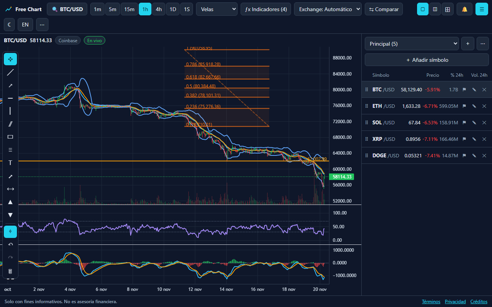
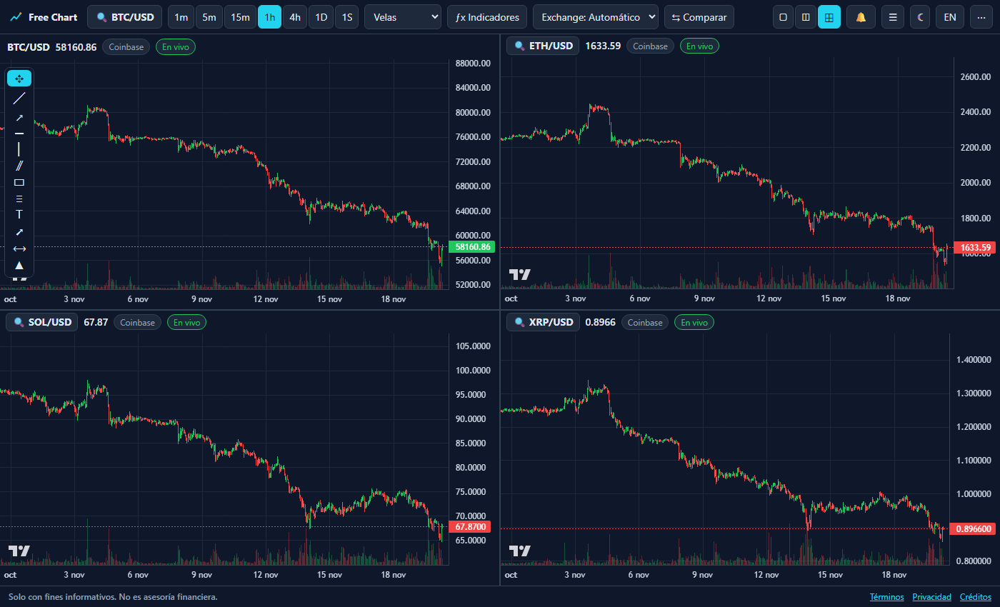
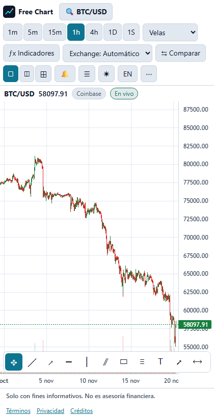

# Free Chart

**ES** · [English below](#english)

Plataforma de gráficas y seguimiento de criptomonedas **gratuita y de código abierto** (MIT), pensada para la comunidad hispanohablante. Sin cuentas, sin servidor, sin analytics: todo corre en tu navegador y se guarda en tu navegador. Costo de operación: $0.



| 4 gráficas con cursor sincronizado | Móvil (tema claro) |
|---|---|
|  |  |

## Qué incluye

- **Gráfica**: velas, línea, área y Heikin Ashi; volumen; temporalidades 1m, 5m, 15m, 1h, 4h, 1D, 1S; precio en tiempo real por WebSocket; tema oscuro/claro; instalable como PWA.
- **Listas ilimitadas**: activos ilimitados, buscador en todos los exchanges, columnas ordenables (precio, % 24h, volumen), 7 banderas de color, notas, arrastrar para reordenar, importar/exportar JSON y CSV, compartir por enlace (la lista viaja dentro de la URL, sin servidor).
- **Indicadores ilimitados por gráfica**: SMA, EMA, WMA, VWAP, Bollinger, Ichimoku, Supertrend, Parabolic SAR; en panel inferior RSI, MACD, Stoch RSI, ATR, OBV, ADX y Volumen. Parámetros, color y grosor editables; plantillas. Cálculos propios con pruebas contra valores conocidos.
- **Dibujo**: tendencia, rayo, horizontal, vertical, canal, rectángulo, Fibonacci, texto, flecha, regla (% y precio) y posición larga/corta (R:R). Seleccionar, mover, editar, borrar, imán a OHLC, deshacer/rehacer (Ctrl+Z / Ctrl+Y), guardado por símbolo; funciona con ratón y táctil.
- **Extras**: diseños de 1, 2 y 4 gráficas, alertas de precio ilimitadas (notificación del navegador + sonido; **solo funcionan con la pestaña abierta**), comparar símbolos en %, atajos de teclado (`?` para verlos), captura PNG, respaldo/restauración total en JSON, español e inglés.

> Solo con fines informativos. No es asesoría financiera.

## Fuentes de datos

Solo endpoints **públicos** de exchanges, llamados desde tu navegador, sin claves y respetando límites de uso (limitador de tasa por exchange, caché en memoria + IndexedDB, reconexión de WebSocket con backoff).

| Exchange | Estado | Notas |
|---|---|---|
| Coinbase Exchange | verificado | Automático (1.º). Permite EE.UU. 4h y 1S se agregan desde 1h / 1D. |
| Kraken | verificado | Automático (2.º). Permite EE.UU. Historial de 720 velas. |
| Binance (`data-api.binance.vision`) | verificado | **Solo manual**. No disponible para residentes de EE.UU. |
| OKX | verificado | **Solo manual**. No disponible para residentes de EE.UU. |
| Bybit | implementado, sin verificar en vivo | **Solo manual**. No disponible para residentes de EE.UU. (devolvió 403 desde la red de pruebas). |

El modo **Automático** usa Coinbase → Kraken. Binance/OKX/Bybit solo se usan si los eliges a mano, con un aviso para residentes de EE.UU. Si un exchange falla o está bloqueado, se cambia al siguiente automáticamente. Detalles de las pruebas en [NOTES.md](NOTES.md).

## Cómo correrlo

Requisitos: Node.js 22+ y Git.

```powershell
npm install
npm run dev        # http://localhost:5173
npm run lint
npm test
npm run build      # genera dist/
npm run licenses   # audita las licencias de las dependencias
```

Prueba opcional contra los exchanges reales (no corre por defecto):

```powershell
$env:LIVE = "1"; npx vitest run src/exchanges/live.test.ts
```

## Cómo desplegarlo gratis

Es un sitio estático (`dist/`). Los archivos `vercel.json` y `public/_headers` incluyen una política de seguridad (CSP) que solo permite conectar a los exchanges listados.

- **Vercel**: importa el repositorio; detecta Vite y usa `vercel.json`.
- **Cloudflare Pages**: build `npm run build`, salida `dist`. Los encabezados salen de `public/_headers`.
- **GitHub Pages**: activa *Settings → Pages → Source: GitHub Actions*. El flujo `.github/workflows/deploy-pages.yml` compila con `BASE_PATH=/Free-Chart/` (cámbialo si tu repositorio se llama distinto).

## Cómo agregar un exchange nuevo

1. Comprueba que tenga endpoints públicos con CORS desde el navegador (`curl -i -H "Origin: http://localhost:5173" <url>` debe devolver `Access-Control-Allow-Origin`) y revisa sus términos y regiones no permitidas.
2. Crea `src/exchanges/<nombre>.ts` implementando `ExchangeAdapter` (`src/exchanges/types.ts`): `toNative`, `buscarSimbolos`, `velasHistoricas` (ascendente; soporta `before` para paginar), `streamTiempoReal` (usa `ReconnectingSocket`) y `ticker24h`. Usa `getJson` + un `RateLimiter` propio. Si faltan 4h o 1S, agrégalas con `aggregateCandles`.
3. Regístralo en `src/exchanges/registry.ts`. Si no permite EE.UU., pon `usRestricted: true` y déjalo fuera de `AUTO_ORDER`.
4. Añade pruebas con `fetch` simulado (ver `src/exchanges/exchanges.test.ts`) y un caso en `live.test.ts`.
5. Documenta el resultado de la verificación en `NOTES.md` y la licencia/uso en `CREDITS.md`.

## Cómo contribuir

Abre un issue o un pull request. Antes de enviarlo: `npm run lint`, `npm test` y `npm run build` deben terminar sin errores. Cualquier dependencia nueva debe ser MIT, Apache-2.0, BSD o ISC (`npm run licenses`) y quedar listada en `CREDITS.md`. No se acepta código ni identidad visual copiados de otras plataformas.

## Créditos y licencia

MIT, ver [LICENSE](LICENSE). Usa [Lightweight Charts™](https://www.tradingview.com/lightweight-charts/) de TradingView, Inc. (Apache-2.0); el logo de atribución permanece visible en la gráfica y el aviso se muestra en la página *Créditos*. Free Chart no está afiliado ni respaldado por TradingView. Lista completa en [CREDITS.md](CREDITS.md).

---

## English

**Free, open-source (MIT) crypto charting and tracking** for the Spanish-speaking community (UI available in Spanish and English). No accounts, no backend, no analytics: everything runs and is stored in your browser. Running cost: $0.

### Features

- **Charts**: candles, line, area, Heikin Ashi; volume; 1m–1W timeframes; real-time WebSocket price; dark/light theme; installable PWA.
- **Unlimited watchlists**: unlimited assets, cross-exchange search, sortable columns, 7 colour flags, notes, drag to reorder, JSON/CSV import/export, share by link (the list is encoded in the URL, no server).
- **Unlimited indicators per chart**: SMA, EMA, WMA, VWAP, Bollinger, Ichimoku, Supertrend, Parabolic SAR; RSI, MACD, Stoch RSI, ATR, OBV, ADX and Volume in lower panes. Editable parameters/colours/width; templates. Own implementations, unit-tested against known values.
- **Drawing**: trend line, ray, horizontal/vertical line, parallel channel, rectangle, Fibonacci, text, arrow, ruler, long/short position (R:R); select/move/edit/delete, OHLC snapping, undo/redo, saved per symbol; mouse and touch.
- **Extras**: 1/2/4-chart layouts with synced crosshair, unlimited price alerts (browser notification + sound; **only while the tab is open**), compare symbols in %, keyboard shortcuts (`?`), PNG screenshot, full JSON backup/restore, Spanish/English.

> For informational purposes only. Not financial advice.

### Data sources

Public exchange endpoints only, called from your browser, no API keys, rate-limited and cached. **Automatic** mode tries Coinbase → Kraken. Binance, OKX and Bybit are **manual-only** and show a notice because they are not available to US residents. See the table above and [NOTES.md](NOTES.md).

### Run it

```powershell
npm install
npm run dev
npm run lint && npm test && npm run build
```

### Deploy for free

Static site (`dist/`): Vercel (`vercel.json`), Cloudflare Pages (`public/_headers`) or GitHub Pages (`.github/workflows/deploy-pages.yml`, sets `BASE_PATH=/Free-Chart/`).

### Add an exchange / contribute

Implement `ExchangeAdapter` in `src/exchanges/<name>.ts`, register it in `registry.ts` (mark `usRestricted` if it excludes US residents), add mocked tests, document the CORS/region check in `NOTES.md`. Dependencies must be MIT/Apache-2.0/BSD/ISC (`npm run licenses`).

### Credits & license

MIT. Built with [Lightweight Charts™](https://www.tradingview.com/lightweight-charts/) by TradingView, Inc. (Apache-2.0); the attribution logo stays visible. Free Chart is not affiliated with or endorsed by TradingView. See [CREDITS.md](CREDITS.md).
